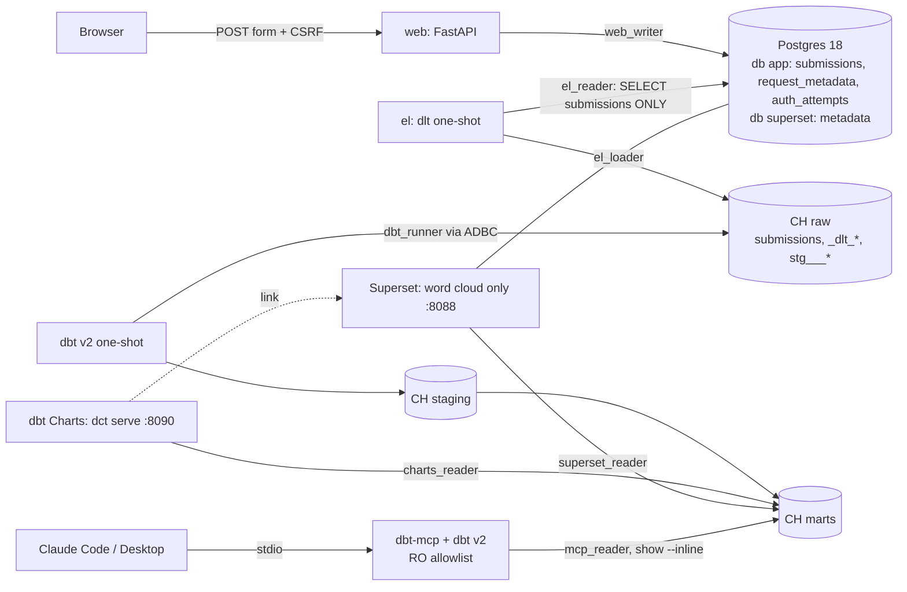

# Architecture

A modular monorepo: one container per runtime concern, one least-privilege
database user per service.

The `raw_staging` database from the original plan is created but unused.
dlt writes its merge staging tables next to the target, as `raw.stg___*`
(owned by `el_loader`).

## Components

| Component | Image | Compose profile | Responsibility |
|---|---|---|---|
| postgres | `postgres:18.6` | core | App OLTP database `app` and Superset metadata database `superset` |
| clickhouse | `clickhouse-server:26.3.54.6` | core | `raw`, `staging`, `marts` (and unused `raw_staging`) |
| migrate | web image | app | Alembic one-shot |
| web | web image (FastAPI + Jinja2) | app | The form, UA parsing, CSRF, rate limit, 3-table insert |
| el | el image (dlt 1.31) | el | Incremental merge of `app.submissions` into `raw.submissions` |
| dbt | transform image (dbt 2.0.8) | dbt | Seeds, models, tests, freshness, docs. One-shot |
| dbt-mcp | transform image + dbt-mcp 2.7.0 | mcp | Read-only stdio server for Claude, target `mcp` |
| charts | `dashboard/charts` image (dbt-charts 0.9.1) | dashboard | `dct serve` for the overview and words boards |
| superset-init, superset | `dashboard/superset` image (Superset 6.1.0) | dashboard | The word cloud only, provisioned from a committed bundle |

## Data flow

1. The browser posts the form. `web` checks CSRF, password and length, then in
   one transaction writes `submissions`, `request_metadata` and
   `auth_attempts`. A wrong password writes only `auth_attempts`.
2. `task el` runs dlt. It reads only `submissions` incrementally on
   `updated_at` and merges on `id` into `raw.submissions`. Soft deletes
   (`deleted_at`) arrive as updates. Hard deletes do not propagate.
3. `task dbt:build` deduplicates raw with `argMax` in
   `staging.stg_app__submissions`, tokenizes messages in SQL, and builds the
   `marts` tables. Every model and column has a description for agents.
4. Readers (`charts_reader`, `superset_reader`, `mcp_reader`) can SELECT
   `marts` only, under the `reader` profile (`readonly=2` with locked limits).
5. dbt Charts reads the manifest built by `dbt parse --target charts`.
   Claude queries marts through `show --inline`.

Grants are at database level so they survive dbt rebuilds. See
`docs/grants-matrix.md`.

## PII

The IP is never stored raw (truncated, then HMAC). The raw user agent and
language stay in `request_metadata`, which never leaves Postgres. Only the
message and the browser and OS families reach the warehouse. Details and
hardening: [pii.md](pii.md).

## Out of scope

ChatGPT or any public MCP endpoint, the dbt Semantic Layer (unsupported by the
dbt v2 ClickHouse adapter), and multi-node ClickHouse.
