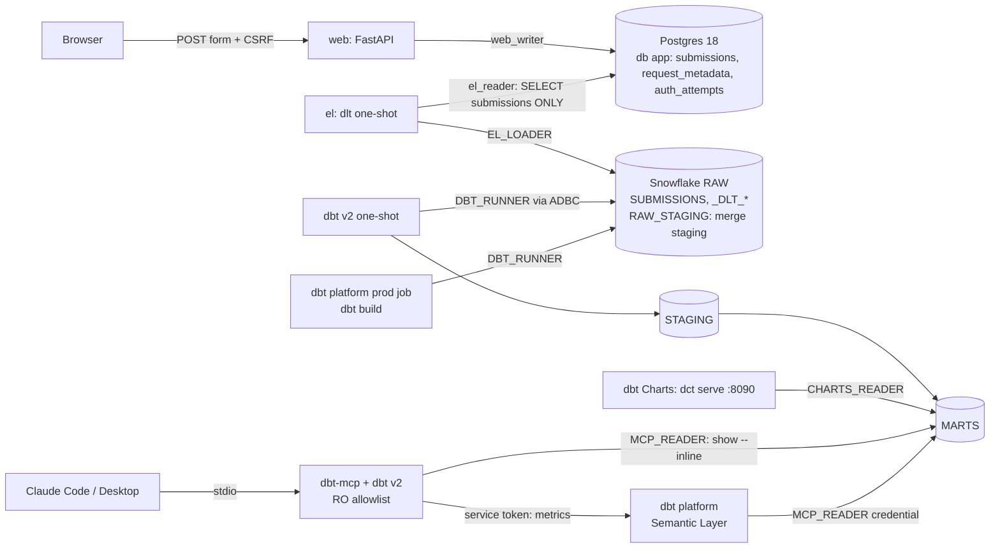

# Architecture

A modular monorepo: one container per runtime concern, one least-privilege
database user per service. Postgres, the web app and the tools run locally in
Docker. The warehouse (Snowflake) and the Semantic Layer (dbt platform) are
remote.

dlt's Snowflake destination folds names to upper case and merges through a
second schema, `RAW_STAGING`, next to the target (both owned by `EL_LOADER`).
dbt references the upper-case names unquoted.

## Components

| Component | Image | Compose profile | Responsibility |
|---|---|---|---|
| postgres | `postgres:18.6` | core | App OLTP database `app` |
| migrate | web image | app | Alembic one-shot |
| web | web image (FastAPI + Jinja2) | app | The form, UA parsing, CSRF, rate limit, 3-table insert |
| el | el image (dlt 1.31) | el | Incremental merge of `app.submissions` into `RAW.SUBMISSIONS` |
| dbt | transform image (dbt 2.0.8) | dbt | Seeds, models, tests, freshness, docs. One-shot |
| dbt-mcp | transform image + dbt-mcp 2.7.0 | mcp | Read-only stdio server for Claude: local tools on target `mcp` and the Semantic Layer tools |
| charts | `dashboard/charts` image (dbt-charts 0.9.1) | dashboard | `dct serve` for the overview and words boards |

Remote, not in compose:

| Service | Holds |
|---|---|
| Snowflake | Database `AICTX` (`RAW`, `RAW_STAGING`, `STAGING`, `MARTS`), three XS warehouses, a resource monitor, one role and user per service. Created by `infra/snowflake/setup.sql` |
| dbt platform | The project, a production environment and job, the Semantic Layer credential and service token. Set up by hand: [semantic-layer.md](semantic-layer.md) |

## Data flow

1. The browser posts the form. `web` checks CSRF, password and length, then in
   one transaction writes `submissions`, `request_metadata` and
   `auth_attempts`. A wrong password writes only `auth_attempts`.
2. `task el` runs dlt. It reads only `submissions` incrementally on
   `updated_at` and merges on `id` into `RAW.SUBMISSIONS`. Soft deletes
   (`deleted_at`) arrive as updates. Hard deletes do not propagate.
3. `task dbt:build` deduplicates raw with `max_by` in
   `STAGING.STG_APP__SUBMISSIONS`, tokenizes messages in SQL, and builds the
   `MARTS` tables. Every model, column and metric has a description for agents.
4. The dbt platform production job runs the same `dbt build` against the same
   schemas. The Semantic Layer serves the metrics from `fct_submissions`
   (defined in `models/marts/_marts.yml`) once that job has succeeded.
5. Readers (`CHARTS_READER`, `MCP_READER`) can `SELECT` on `MARTS` only. Each
   query is capped at 30 s on the user and the reader warehouse.
6. dbt Charts reads the manifest built by `dbt parse --target charts`. Claude
   queries marts through `show --inline` and metrics through `query_metrics`.

Grants are on schemas, with `FUTURE` grants for readers, so they survive dbt
rebuilding a table (`CREATE OR REPLACE` drops grants on the old object). See
[grants-matrix.md](grants-matrix.md).

## PII

The IP is never stored raw (truncated, then HMAC). The raw user agent and
language stay in `request_metadata`, which never leaves Postgres. Only the
message and the browser and OS families reach the warehouse, which is now a
third-party cloud service. Details and hardening: [pii.md](pii.md).

## Out of scope

ChatGPT or any public MCP endpoint, and multi-region or multi-account
warehouses.

## Moved from the first design

The first version ran ClickHouse locally, and dbt v2's ClickHouse adapter has no
Semantic Layer support, so metrics could only be documented, not queried. The
migration to Snowflake and the dbt platform is what makes the Semantic Layer
real. It also made the stack depend on two remote services: it no longer runs
offline, and the warehouse costs credits (XS warehouses, 60 s auto-suspend, a
monthly resource monitor).
