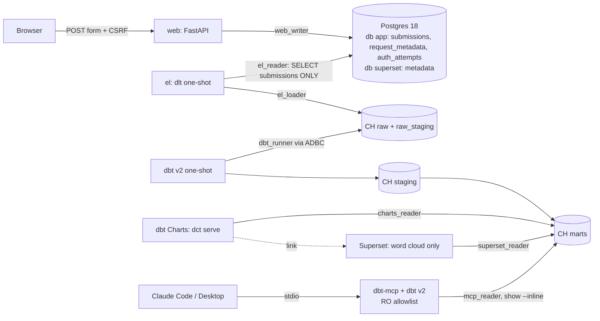

# Plan: ai-context-with-dbt — local ELT demo (Postgres → ClickHouse → dbt v2 → dbt Charts + dbt MCP)

## Context
The repo is empty: only `spec.md` on `main`, no commits. The spec asks for a teaching demo of a full ELT cycle that AI agents can query:
- A one-page app writes to Postgres.
- dlt copies one table raw into ClickHouse.
- **dbt v2** builds staging and marts with descriptions that help agents.
- **dbt Charts** draws the marts. Superset is used only for the word cloud.
- dbt-mcp lets Claude query the marts.
- Docker Compose runs it all, and go-task drives it.

How the plan was made:
- Versions verified on 2026-10-17 (§2).
- Drafted by `voltagent-core-dev:microservices-architect`.
- Reviewed by `voltagent-qa-sec:architect-reviewer` (18 findings, §9a).
- Revised after your review (3 comments, §9b): use dbt v2, use dbt Charts, drop ChatGPT.

> ⚠️ The fixed password `dssbr` is **intentionally insecure and for the local demo only**. It lives in `.env`, templated by `.env.example`, never in source.

---

## 1. Summary and key decisions

| Decision | Options considered | Choice | Rationale |
|---|---|---|---|
| Architecture | Microservices; modular monolith | **Modular monorepo**, one container per runtime concern | Shows real boundaries and least-privilege access without mesh or discovery overhead |
| Python layout | Per-service projects; single uv workspace | **uv workspace** (`apps/web`, `apps/el`, `transform`) on Python 3.13. **`dashboard/charts` is its own uv project.** | One lock for the core. dbt-charts pulls in dbt-core 1.x, whose `dbt` entrypoint would clash with dbt v2's, so it gets a separate lock and image. |
| Web stack | FastAPI, Flask, Django | **FastAPI 0.143.3 + Jinja2**, sync handlers, psycopg 3, Alembic | Small and typed. Sync handlers mean no async test burden. |
| Browser/OS capture | Server-side UA parsing; UA Client Hints / JS | **Server-side `ua-parser`** | *Accuracy:* Firefox and Safari send no UA-CH, and families are all we need. *Privacy:* no JS fingerprinting. The raw UA goes only to an excluded table. |
| EL tool | dlt, Airbyte, custom, PG table engine, MaterializedPostgreSQL | **dlt 1.31.0** `sql_database` → `clickhouse` | Real incremental, merge and state handling in one small container. Airbyte is too heavy. The engine options hide the EL step. |
| EL trigger | after-submit, cron, manual | **Manual `task el`** | Deterministic for e2e and easy to teach |
| Raw engine | ReplacingMergeTree; MergeTree + merge | **MergeTree (dlt-managed) + dlt `merge` on `id`**, with `argMax` dedup in staging | dlt's ClickHouse adapter has no ReplacingMergeTree |
| **dbt engine** | dbt Core 1.12 + dbt-clickhouse; **dbt v2** | **dbt v2 (`dbt==2.0.8`, ClickHouse adapter built in, public beta)**, per your review | The ClickHouse adapter ships inside the binary and connects over ADBC. Accepted beta gaps: no Semantic Layer, no dbt `grants:` (we grant at DB level anyway), static analysis off, single-node only. |
| Tokenization | Python; ClickHouse SQL | **ClickHouse SQL** | Runs where the data is and is testable in dbt |
| Agent semantics | MetricFlow; descriptions | **Rich descriptions** (+ semantic YAML only if v2 parses it) | MetricFlow and the SL are unsupported on v2/ClickHouse and need the dbt platform anyway |
| **Dashboard** | dbt Charts, Superset, Lightdash, Metabase, Evidence | **dbt Charts 0.9.1** (`dct serve`) for every chart it supports, plus **Superset 6.1.0 for the word cloud only** | Per your review. dbt Charts boards are YAML next to the dbt models, so they're provisioned as code by design. It has no word-cloud type. |
| Claude MCP | host `uvx`; container stdio | **dbt-mcp container over stdio** (`docker compose run --rm -i dbt-mcp`) | The image bundles dbt-mcp 2.7.0 and the dbt v2 binary, so there's no host/container path drift |
| ChatGPT MCP | (n/a) | **Out of scope**, per your review | (n/a) |
| Secrets | (none) | `.env` (gitignored) generated by `task setup`; one least-privilege user per service | Spec requirement |

## 2. Verified versions and docs (checked 2026-10-17)

| Tool | Pin | Notes | Source |
|---|---|---|---|
| **dbt v2** (`dbt` on PyPI) | 2.0.8 | Rust engine. ClickHouse adapter built in (public beta since 2026-09-16, "dev/staging only"). Downloads the ClickHouse ADBC driver on first use. Not yet: Semantic Layer/MetricFlow, grants, `ON CLUSTER`. Static analysis is forced off. Data and unit tests and catalog generation are supported. Needs ClickHouse ≥25.3. | https://pypi.org/project/dbt/ ; https://clickhouse.com/blog/clickhouse-is-now-available-on-the-dbt-platform ; https://clickhouse.com/docs/integrations/connectors/data-ingestion/etl-tools/dbt/dbt-core-v2-fusion-and-platform |
| **dbt-charts** (`dct` CLI) | 0.9.1 (2026-10-02) | Apache-2.0, from dbt Labs. YAML boards in `charts/`, `dbt_charts.yml` for sources. `[clickhouse]` extra → dbt-core <2 + dbt-clickhouse ≥1.10. ClickHouse readers need `readonly=2`. `dct serve --host 0.0.0.0 --port`, `dct render --format html`, `dct validate`. Common types: line, bar, area, scatter, pie, donut, heatmap, histogram, table, kpi, callout, maps. **No word cloud.** py <3.14. | https://pypi.org/project/dbt-charts/ ; https://dbtcharts.com/ ; https://docs.dbtcharts.com/sources/index.md ; https://docs.dbtcharts.com/charts/index.md ; https://docs.dbtcharts.com/cli/serve.md |
| dbt-core / dbt-clickhouse | 1.12.6 / 1.10.3 | **Only as dependencies of dbt-charts** (its own lock), not used to build | pypi |
| dbt-mcp | 2.7.0 | py ≥3.12,<3.14. `MCP_TRANSPORT` defaults to stdio. Allowlist via `DBT_MCP_ENABLE_TOOLS`. Locally available: dbt CLI tools + `get_node_details_dev`/`get_lineage_dev`. SL, Discovery and `execute_sql` need the dbt platform. Supports dbt Core, Fusion and the platform. | https://github.com/dbt-labs/dbt-mcp ; https://docs.getdbt.com/docs/dbt-ai/setup-local-mcp |
| dlt | 1.31.0 | extras `sql-database`, `postgres`, `clickhouse` | https://pypi.org/project/dlt/ |
| FastAPI | 0.143.3 | | https://pypi.org/project/fastapi/ |
| clickhouse-connect | 1.11.0 | dlt and Superset driver | https://pypi.org/project/clickhouse-connect/ |
| ClickHouse | `clickhouse/clickhouse-server:26.3.54.6` (LTS) | amd64 and arm64 | https://hub.docker.com/r/clickhouse/clickhouse-server |
| Postgres | `postgres:18.6` | arm64. Volume mounts at `/var/lib/postgresql`. | https://hub.docker.com/_/postgres |
| Apache Superset | `apache/superset:6.1.0` | amd64 and arm64. Native Word Cloud chart. | https://pypi.org/project/apache-superset/ ; https://superset.apache.org/docs/databases/clickhouse/ |
| go-task / uv | 3.54.0 / 0.13.1 | | GitHub releases |
| *Verify at milestone start* | `dbt` 2.0.8 linux-aarch64 wheel and ADBC driver arm64 availability; psycopg, Alembic, Jinja2, ua-parser, ruff, pytest, anyio, httpx | | PyPI |

`.tool-versions`: `python 3.13.x` · `uv 0.13.1` · `task 3.54.0`

## 3. Architecture and data flow



| Component | Image | Profile | Responsibility |
|---|---|---|---|
| postgres | `postgres:18.6` | core | App OLTP + Superset metadata (separate database and owner) |
| clickhouse | `clickhouse-server:26.3.54.6` | core | `raw`, `raw_staging`, `staging`, `marts` |
| migrate / web | web image | app | Alembic one-shot / form app |
| el | el image, one-shot | el | dlt incremental merge of `submissions` |
| dbt | transform image (`dbt==2.0.8`), one-shot | dbt | build, test, freshness, docs generate. ADBC driver cached in volume `dbt_adbc`. |
| dbt-mcp | transform image + dbt-mcp 2.7.0 | mcp | stdio, target `mcp`, own `target_mcp/` |
| charts | `dashboard/charts` image (dbt-charts[clickhouse]) | dashboard | `dct serve --host 0.0.0.0 --port 8090` over `dashboard/charts/charts/*.yml`, `server.debug: false` |
| superset-init → superset | `infra/superset` image | dashboard | One word-cloud chart and dashboard, provisioned from a bundle; 127.0.0.1:8088 |

## 4. Repo layout

```
ai-context-with-dbt/
├── .tool-versions  .gitignore  .env.example  .mcp.json  README.md
├── pyproject.toml  uv.lock          # workspace: apps/web, apps/el, transform; ruff 88; pytest
├── docker-compose.yml               # profiles: core, app, el, dbt, mcp, dashboard
├── Taskfile.yml
├── apps/
│   ├── web/  {pyproject.toml, Dockerfile, src/web/…, templates/index.html, migrations/, tests/}
│   └── el/   {pyproject.toml, Dockerfile, src/el/{pipeline,settings}.py, tests/}
├── transform/                       # workspace member: dbt==2.0.8, dbt-mcp==2.7.0
│   ├── pyproject.toml  Dockerfile   # stages: dbt, dbt-mcp
│   └── dbt/ {dbt_project.yml, profiles.yml (env_var; targets dev, ci, mcp, charts),
│             models/{staging,marts}/, seeds/, macros/, tests/}
├── dashboard/
│   ├── charts/                      # standalone uv project (own lock): dbt-charts[clickhouse]==0.9.1
│   │   ├── pyproject.toml  uv.lock  Dockerfile  dbt_charts.yml
│   │   └── charts/{overview.yml, words.yml}
│   └── superset/{Dockerfile, pyproject.toml, uv.lock, superset_config.py, init.sh, bundle/}
├── infra/{postgres/init/, clickhouse/{config.d,users.d,init/}}
├── mcp/claude_desktop_config.example.json
├── scripts/e2e/                     # payloads, assertion SQL, runner
└── docs/                            # architecture, pii, grants-matrix, debugging, agent-guide, test-strategy
```

Superset's driver goes in with `UV_PROJECT_ENVIRONMENT=/app/.venv uv sync --frozen --inexact --no-install-project` from `dashboard/superset/uv.lock`. That means no `pip` and no `uv pip`. First check whether the image already ships `clickhouse_connect`. dbt-charts is installed with `uv sync --frozen` from its own lock.

## 5. Schemas

### 5.1 Postgres (database `app`, schema `app`)

```sql
CREATE TABLE app.submissions (                    -- MAIN: the only table extracted
  id             bigint GENERATED ALWAYS AS IDENTITY PRIMARY KEY,
  message        varchar(280) NOT NULL
                 CHECK (char_length(btrim(message)) BETWEEN 1 AND 280),
  browser_family text NOT NULL,
  os_family      text NOT NULL,
  created_at     timestamptz NOT NULL DEFAULT now(),
  updated_at     timestamptz NOT NULL DEFAULT now(),  -- incremental cursor; BEFORE UPDATE trigger
  deleted_at     timestamptz NULL                 -- soft delete (bumps updated_at)
);
CREATE INDEX submissions_updated_at_idx ON app.submissions (updated_at, id);

CREATE TABLE app.request_metadata (               -- AUX: excluded (PII-adjacent)
  submission_id   bigint PRIMARY KEY REFERENCES app.submissions(id) ON DELETE CASCADE,
  user_agent_raw  text NOT NULL CHECK (char_length(user_agent_raw) <= 1024),
  ip_hash         char(64) NOT NULL,              -- HMAC-SHA256(IP_SALT, /24 v4 or /48 v6)
  accept_language varchar(128),
  created_at      timestamptz NOT NULL DEFAULT now()
);

CREATE TABLE app.auth_attempts (                  -- AUX: excluded (audit + rate limit)
  id            bigint GENERATED ALWAYS AS IDENTITY PRIMARY KEY,
  attempted_at  timestamptz NOT NULL DEFAULT now(),
  ip_hash       char(64) NOT NULL,
  success       boolean NOT NULL,
  reason        text NOT NULL CHECK (reason IN
                ('ok','bad_password','rate_limited','csrf','invalid_input')),
  submission_id bigint NULL REFERENCES app.submissions(id) ON DELETE SET NULL
);
CREATE INDEX auth_attempts_ip_time_idx ON app.auth_attempts (ip_hash, attempted_at DESC);
```

| Table | Extracted? | Why |
|---|---|---|
| `submissions` | **Yes** | Analytic fact. Cursor is `updated_at`, merge key is `id`. |
| `request_metadata` | No | Raw UA, IP hash and language. Only for debugging or re-parsing. |
| `auth_attempts` | No | Operational audit and rate-limit source. Holds failures but no message text. |

On the correct password, one transaction writes rows to all 3 tables. On a wrong password, only `auth_attempts` gets a row.

**PII**

| Data | Where it lives | Reaches the warehouse? | Treatment |
|---|---|---|---|
| IP address | never stored raw | No | Truncated, then HMAC'd. Used only for rate limiting. |
| Raw UA | `request_metadata` | No | Only browser and OS families flow downstream |
| Accept-Language | `request_metadata` | No | (n/a) |
| Message | `submissions` | **Yes**, needed for the word cloud | "No personal data" notice on the page. Never logged. Max 280 chars. Readers can see it in `marts.fct_submissions`, which is accepted. |
| Password | never stored | No | Only the outcome is recorded |

**Hardening**
- `APP_PASSWORD` comes from env and is compared with `hmac.compare_digest`.
- Rate limit: N failures per `ip_hash` per window, configurable, default 5 per 15 min. It is effectively global under Docker Desktop NAT, which is documented.
- CSRF uses a signed double-submit cookie with `SameSite=Strict`.
- Length is checked three ways: HTML `maxlength`, the server model, and a DB CHECK.
- CSP `default-src 'self'` and a "DEMO ONLY" banner.
- Message bodies are never logged.

**Postgres roles**

| Role | Privileges |
|---|---|
| `app_owner` | Used by Alembic |
| `web_writer` | INSERT on the 3 tables, SELECT on `auth_attempts`, sequence USAGE |
| `el_reader` | **SELECT on `app.submissions` only** (DB-enforced exclusion of the other tables) |
| `superset_meta` | Owns database `superset` |

### 5.2 ClickHouse

| Database | Writer | Contents |
|---|---|---|
| `raw` | `el_loader` | dlt `submissions` table (MergeTree, `ORDER BY id`, no PARTITION BY: tiny data) + `_dlt_loads`, `_dlt_version`, `_dlt_pipeline_state` |
| `raw_staging` | `el_loader` | dlt merge staging tables |
| `staging` | `dbt_runner` | views and seeds |
| `marts` | `dbt_runner` | tables |

```sql
-- expected raw.submissions (dlt-created; name/types confirmed in M5)
-- id Int64, message String, browser_family String, os_family String,
-- created_at DateTime64(6,'UTC'), updated_at DateTime64(6,'UTC'),
-- deleted_at Nullable(DateTime64(6,'UTC')), _dlt_load_id String, _dlt_id String
-- ENGINE = MergeTree ORDER BY id
```

**EL**

| Concern | Decision |
|---|---|
| Selection | `table_names=["submissions"]`. `el_reader` can't read the other tables anyway. |
| Incremental | `incremental("updated_at", lag=small)`, `write_disposition="merge"`, `primary_key="id"` |
| Late updates | The trigger bumps `updated_at`. Overlap from the lag window is idempotent through the merge. |
| Deletes | Soft deletes propagate as `is_deleted`. Hard deletes are **not** propagated, which is documented. |
| Idempotency | Merge (synchronous mutations) plus `argMax` in staging. The check is that `uniqExact(id)` stays stable across reruns. |
| State / failure | State lives in `_dlt_pipeline_state`. Transient errors are retried, then the job exits non-zero. An uncommitted package is retried on the next run. |

**Guardrails**
- `config.d`:
  - `select_from_system_db_requires_grant=1` and `select_from_information_schema_requires_grant=1`
  - Memory ratio 0.75
- `reader` profile:
  - `readonly=2`
  - Constraints: `max_execution_time ≤ 30`, `max_result_rows ≤ 10000`, `max_memory_usage ≤ 1G`, `result_overflow_mode` locked
  - Readers can't lift these with `SETTINGS`
- All grants are **database-level** (`ON marts.*`), so they survive dbt rebuilds. That also covers dbt v2 having no `grants:` support.

| User | raw | raw_staging | staging | marts | system |
|---|---|---|---|---|---|
| `default` | init only | | | | |
| `el_loader` | CREATE, DROP, INSERT, SELECT, ALTER DELETE/UPDATE, TRUNCATE | all | | | |
| `dbt_runner` | SELECT | | CREATE, DROP, INSERT, SELECT, ALTER | CREATE, DROP, INSERT, SELECT, ALTER, EXCHANGE | minimal for introspection |
| `mcp_reader` | ✗ | ✗ | ✗ | SELECT | only what a spike proves is needed |
| `charts_reader` | ✗ | ✗ | ✗ | SELECT | same |
| `superset_reader` | ✗ | ✗ | ✗ | SELECT on `marts.mart_word_frequencies` only | same |

The three reader users all use the `reader` profile. The full matrix is in `docs/grants-matrix.md`, and e2e asserts every ✗.

### 5.3 dbt models (dbt v2)

**Conventions**
- A `generate_schema_name` override uses custom schemas verbatim (`staging`, `marts`). Seeds land in `staging`.
- Targets `dev`, `ci`, `mcp` and `charts` all resolve refs identically.
- The reader targets use `schema: marts` and `check_exchange: false`. That setting is a v1 profile key, so the M7 spike confirms whether v2 honours or ignores it.
- Every model and column has a description, written as the grain, the questions it answers, and an example query. Avoid `;` in descriptions, because v2 docs persistence fails on it.
- v2 needs the ClickHouse ADBC driver. It is downloaded on first `dbt debug` and persisted in the `dbt_adbc` volume, warmed by `task setup`.

| Model | Mat. | Purpose | Tests |
|---|---|---|---|
| source `app.submissions` | (n/a) | the dlt raw table | freshness on `updated_at`, **warn only**; `not_null(id)` |
| `stg_app__submissions` | view | `argMax` dedup; casts; `is_deleted`; browser and OS normalized via seed `browser_family_map` | unique and not_null `submission_id`; `accepted_values` browser ∈ {Chrome, Firefox, Safari, Edge, Opera, Other}, OS ∈ {Windows, macOS, Linux, iOS, Android, Other} |
| `int_submission_tokens` | ephemeral | non-deleted → `arrayJoin(extractAll(lowerUTF8(message), '\\p{L}+'))` → `normalize_token` (NFD + strip `\\p{Mn}`) → length ≥ 3 → anti-join stopwords | **dbt unit tests** (supported in v2) for PT, EN and accents |
| `fct_submissions` | table | one row per non-deleted submission | unique id; relationships |
| `mart_browser_distribution` | table | browser, count, pct | **custom:** counts sum to `count(fct_submissions)` |
| `mart_os_distribution` | table | os, count, pct | same |
| `mart_browser_os_combinations` | table | ranked browser × OS | unique (browser, os) |
| `mart_submissions_daily` | table | day, count, cumulative | unique day |
| `mart_word_frequencies` | table | `word` (folded), `display_word`, `frequency` | **custom generic:** `no_stopwords`, `min_length(3)`; unique word |

- Stopword seeds (PT and EN) are folded with the **same** macro as tokens. There is no language detection. Apostrophes split words, which is documented.
- Semantic YAML (`semantic_models`/`metrics` + time spine) is **conditional**. Add it only if dbt v2 parses it for a ClickHouse project. Otherwise skip it and record the gap, since the v2 ClickHouse adapter doesn't support the Semantic Layer.

**What agents get locally**
- Descriptions and the docs catalog.
- The manifest via `get_node_details_dev` / `get_lineage_dev`.
- `list`, `compile`, `parse`.
- `show --inline` SQL over `{{ ref('mart_…') }}`. This is the documented pattern. `show --select` on non-mart models fails for `mcp_reader` **by design**.

**Not available:** `list_metrics`, `query_metrics`, the Discovery API, `execute_sql`. These need the dbt platform, and the SL also needs v2 ClickHouse support.

### 5.4 Dashboards

**dbt Charts** (`dashboard/charts`)
- `dbt_charts.yml` declares source `warehouse: {type: dbt_profile, profile: aictx, target: charts}`. The password comes from `env_var()`.
- Boards query `{{ ref('mart_…') }}` against a manifest built with `dbt parse --target charts --target-path target/charts`, written by the dbt v2 container into a shared volume.
- If dbt Charts can't read the v2 manifest, the fallback is fully qualified `marts.<table>` names.

| Board | Charts |
|---|---|
| `overview.yml` | kpi: total submissions · donut: browser distribution · donut: OS distribution · line: submissions per day · table: top browser×OS combinations |
| `words.yml` | bar: top 30 word frequencies (dbt Charts fallback for the word cloud) · callout with a link to the Superset word cloud |

**Superset** (word cloud only)
- One dataset (`marts.mart_word_frequencies`), one native **Word Cloud** chart, one dashboard.
- Provisioned by `init.sh`: `db upgrade` → create admin → `superset init` → render the DB connection from env → import the committed bundle (stable UUIDs, no passwords).
- Authoring the bundle by hand happens once, and that step is documented.

## 6. Docker Compose and Taskfile

**Conventions**
- One `backend` network.
- Volumes: `pg_data` (`/var/lib/postgresql`), `ch_data`, `superset_home`, `dbt_target`, `dbt_adbc`.
- All ports bound to `127.0.0.1`.
- Pinned tags, all with arm64 builds.

| Service | Profile | depends_on | Healthcheck | Mem |
|---|---|---|---|---|
| postgres | core | (none) | `pg_isready` | 512m |
| clickhouse | core | (none) | `/ping` on 8123; nofile 262144 | 2g |
| migrate | app | postgres healthy | one-shot | 256m |
| web | app | migrate completed_successfully | `GET /healthz` | 256m |
| el | el | postgres + clickhouse healthy | one-shot | 512m |
| dbt | dbt | clickhouse healthy | one-shot | 1g |
| dbt-mcp | mcp | clickhouse healthy | (stdio) | 512m |
| charts | dashboard | clickhouse healthy | `GET /` on 8090 | 512m |
| superset-init | dashboard | postgres + clickhouse healthy | one-shot | 1g |
| superset | dashboard | superset-init completed_successfully | `GET /health` | 1.5g |

| Task | Action |
|---|---|
| `setup` | Check asdf tools; `uv sync` (workspace and `dashboard/charts`); create `.env`; warm the ADBC driver (`dbt debug`) |
| `up` / `down` | Start core + app with health waits / stop everything |
| `migrate` · `run-app` · `app:open` · `seed` | Migrations · web · open :8000 · POST sample good and bad submissions |
| `el` | Run the EL one-shot |
| `dbt:build` · `dbt:run` · `dbt:test` · `dbt:freshness` · `dbt:docs` | dbt v2 in a container. Docs: `docs generate`, with the static target served on :8081 if `docs serve` isn't in v2. |
| `dashboard` | `dbt parse --target charts` → start charts + Superset → open http://127.0.0.1:8090 (the board links to Superset :8088) |
| `charts:validate` | `dct validate --warehouse` on all boards |
| `mcp:claude` | Register with Claude Code (`.mcp.json`) and print the Desktop JSON |
| `logs SVC=` · `sh:<svc>` · `psql` · `ch` | Debugging |
| `lint` · `test` | `ruff check`, `ruff format --check`, `uv lock --check` (both locks), `charts:validate` · pytest unit, then `-m integration` |
| `reset` | `down -v`, clean the target dirs |
| `e2e` | Isolated compose project (`-p aictx-e2e`), fresh volumes, runs the steps below |

**`task e2e` asserts**
1. The stack is healthy and migrations are applied.
2. Fixed-UA submissions (3 Chrome/macOS, 2 Firefox/Linux, 1 Mobile Safari/iOS) with PT and EN messages each produce one row in **all 3** tables.
3. A wrong password returns 401, writes no submission, and adds an `auth_attempts.success=false` row.
4. A missing CSRF token or a message over 280 characters is rejected, with no submission written.
5. EL runs twice, and staging `uniqExact(id)` = 6 both times.
6. One soft delete plus a 7th submission, then EL. Raw has 7 ids, and staging has the right `is_deleted`.
7. `dbt build` and `dbt docs generate` exit 0.
8. Marts:
   - Browser counts match, excluding the deleted row.
   - The fixture word frequencies match (`café` and `cafe` merge).
   - No stopwords, no tokens shorter than 3.
9. `system.tables` contains no `request_metadata` or `auth_attempts`.
10. Guardrails:
    - Readers can SELECT `marts`.
    - Readers are denied `raw`, `staging`, `system.query_log`, INSERT, and `SETTINGS max_result_rows=0`.
    - `dbt show --inline … --target mcp` returns rows.
11. Dashboards:
    - `dct render overview.yml --format html` succeeds.
    - The charts and Superset health endpoints return 200.

**Debugging each hop**

| Hop | How |
|---|---|
| web | JSON logs with a request id, no message bodies |
| EL | dlt load info on stdout; `_dlt_loads` |
| dbt | `target/run_results.json`, `logs/dbt.log` |
| charts | `dct doctor`, `dct query warehouse '<sql>'`, container logs |
| Superset | container logs |
| MCP | `DBT_MCP_LOG_LEVEL=DEBUG`; `system.query_log WHERE user='mcp_reader'`, queried as admin |

## 7. Milestones (one stacked git-town branch each)

**Git**
- First commit on `main`: `chore: initial commit` (`.gitignore`, README stub).
- Then `git town hack m00-bootstrap`, then `git town append <name>` for each later milestone.
- `git town sync --stack` after each milestone, `git town propose` per branch.
- Conventional Commits, with **no co-authored-by lines and no tool or AI attribution** in commits or PRs.
- Every PR also gets a pass from `voltagent-qa-sec:code-reviewer`.

| # | Branch | Owner (justification) | Scope | Acceptance | Verification |
|---|---|---|---|---|---|
| M0 | `m00-bootstrap` | `voltagent-lang:python-pro`: uv workspace, typing and ruff conventions | `.tool-versions`, workspace `pyproject`, ruff (88), pytest + anyio, Taskfile skeleton, `.env.example`, `.gitignore` | `uv sync` resolves (incl. `dbt==2.0.8` on arm64); `task lint test` green | `uv lock --check`; `task --list` |
| M1 | `m01-infra-core` | `voltagent-infra:docker-expert`: Compose profiles, healthchecks, arm64 images, PG18 volume layout | postgres + clickhouse, network, volumes, limits, CH `config.d`; `task up/down/psql/ch/reset/logs` | `task up` healthy in under 60 s on Apple Silicon | `docker compose ps`; `/ping`; `pg_isready` |
| M2 | `m02-e2e-skeleton` | `voltagent-qa-sec:test-automator`: e2e harness early so each later milestone adds its own assertions | `scripts/e2e` runner, isolated compose project, psql/ch helpers, health stage; `task e2e` | Health stage green from clean volumes | Run twice from `reset` |
| M3 | `m03-datastores-access` | `voltagent-infra:database-administrator`: one owner for PG and CH roles, grants and constraint profiles | Alembic migrations, PG roles, CH databases, users, `reader` profile, DB-level grants, `docs/grants-matrix.md`, `docs/pii.md` | `upgrade → downgrade base → upgrade` clean; every matrix cell behaves as specified | e2e grant stage |
| M4 | `m04-web-app` | `voltagent-lang:fastapi-developer`: FastAPI, Jinja, form security, TestClient tests | Page, UA parsing, compare_digest, CSRF, rate limit, validation, transactional 3-table insert, `/healthz`, Dockerfile, `task run-app/seed` | Correct password → 3 rows; wrong → only `auth_attempts`; N+1th failure → 429 | Unit (UA table, CSRF, validation edges, rate window) + integration; e2e 2–4 |
| M5 | `m05-el-dlt` | `voltagent-data-ai:data-engineer`: incremental, merge and state semantics | Spike (naming, staging DB, mutation sync), pipeline, `task el`, Dockerfile | Stable reruns; new row arrives; soft delete propagates; no aux tables; non-zero exit when CH is down | Integration test runs twice; CH-down test; e2e 5–6, 9 |
| M6 | `m06-dbt-v2-models` | `voltagent-data-ai:data-engineer`: layered modelling in ClickHouse SQL, tests and agent-facing descriptions | dbt v2 image with ADBC driver cache, profiles (dev, ci, mcp, charts), schema macro, seeds, `normalize_token`, models, custom and unit tests, freshness, descriptions, semantic YAML probe, `docs/agent-guide.md` | `dbt build` green on v2; `docs generate` OK; seeded marts match; 100% description coverage | `task dbt:build`; coverage check; e2e 7–8 |
| M7 | `m07-mcp-claude` | `voltagent-data-ai:ai-engineer`: agent tool integration and allowlisting | dbt-mcp image stage (dbt-mcp 2.7.0 + dbt v2), `mcp` service, `DBT_MCP_ENABLE_TOOLS=show,list,compile,parse,get_node_details_dev,get_lineage_dev`, `--target mcp`, `target_mcp/`, `.mcp.json`, Desktop example; spike `dbt debug/parse/compile/show --inline/ls` as `mcp_reader` on v2 | Claude lists **only** those 6 tools and answers "what are the top browsers?" from `marts` | Transcript in `docs/`; `query_log` shows only `mcp_reader` SELECTs; e2e 10 |
| M8 | `m08-dashboards` | `voltagent-data-ai:data-analyst`: chart selection and board design (`voltagent-infra:docker-expert` reviews the images and init) | `dashboard/charts` project + image, `dbt_charts.yml`, boards `overview.yml` and `words.yml`; Superset image (lock-based driver install), init, word-cloud bundle; `task dashboard`, `charts:validate` | `task reset && … && task dashboard` opens populated boards and the word cloud with no clicking; no secrets in the bundle | `dct validate --warehouse`; `dct render`; grep the bundle; e2e 11 |
| M9 | `m09-e2e-docs` | `voltagent-qa-sec:test-automator`: closes out the test pyramid | Complete e2e, `docs/test-strategy.md`, `docs/debugging.md`, README quickstart | `task e2e` green twice in a row from clean | Fresh clone |
| M10 | `m10-review` | `voltagent-qa-sec:architect-reviewer`: final architecture gate against this plan and the spec | Review fixes, final code-reviewer sweep (types, docstrings, 88 cols, no logged PII, no secrets) | Findings resolved; `task lint test e2e` green | Reviewer sign-off |

**Testing strategy.** Owner is `voltagent-qa-sec:qa-expert` (pyramid and gates). `voltagent-qa-sec:test-automator` implements it.

| Layer | What it covers |
|---|---|
| Unit | UA mapping, CSRF, validation, rate window, EL config |
| Integration | Real containers, `@pytest.mark.integration` |
| dbt | Generic, custom, unit and freshness tests |
| Dashboards | `dct validate` |
| E2E | `task e2e` |

Async tests use anyio.

## 8. Tradeoffs, explained to you

| Topic | Tradeoff | Recommendation |
|---|---|---|
| **Microservices vs. modular monolith** | Real microservices would be most of the work and teach nothing about ELT. One container per concern still shows the boundaries. | Modular monorepo |
| **ClickHouse for tiny data** | It's overkill for performance: no partitions, one node, a 2 GB cap. It still teaches columnar storage, MergeTree, the OLTP/OLAP split, settings constraints and grants. | Keep it, configure it minimally, and document what changes at scale |
| **EL tool** | Custom code hides state handling. Airbyte is heavy. The engine options skip the "L". dlt owns the table engine, so dedup moves to staging. | dlt |
| **dbt v2 (your choice)** | Gains: the current engine, faster parses, a built-in adapter, and lined up with where dbt is going. Costs: public beta ("dev/staging only"); no SL, grants or static analysis on ClickHouse; the ADBC driver is downloaded at runtime; the tooling around it (dbt-charts manifest, dbt-mcp) is less battle-tested on v2. | Use v2 as you asked. Every gap has a mitigation: DB-level grants, conditional semantic YAML, and spikes in M6 and M7. dbt Core 1.12.6 + dbt-clickhouse 1.10.3 is the fallback if a blocker shows up. |
| **Dashboard (your choice)** | dbt Charts is dbt-native, YAML in git, so provisioning as code comes for free, and it's lightweight. But it's young (0.9.x) and has no word cloud. Superset only for the word cloud adds a second BI tool and about 1.5 GB of RAM for one chart. | dbt Charts for every chart, plus a word-frequency bar. Superset for the word cloud as you asked. If RAM gets tight, drop Superset and keep the bar chart. |
| **Semantic layer: local vs. dbt Cloud** | The SL needs the dbt platform, and v2's ClickHouse adapter doesn't support it yet. Locally, agents rely on descriptions plus `show --inline` on marts. | Write rich descriptions now. Revisit when v2 adds SL support for ClickHouse. |
| **ChatGPT** | Removed from scope per your review. That avoids the public-endpoint and no-auth risk entirely. | (n/a) |
| **Fixed password `dssbr`** | It's insecure by design to keep the demo simple. | Keep it in env, with constant-time compare, rate limit, CSRF, length checks and a banner |
| **Reviewer-flagged** | Read-only dbt connections need care. Without fixes, readers could lift limits or read `system.query_log`, and grants would vanish on rebuild. | Fixed in §5.2 and §9a |

## 9. Review findings and resolutions

### 9a. `voltagent-qa-sec:architect-reviewer` (draft v1)

| # | Sev | Finding | Resolution |
|---|---|---|---|
| 1 | H | `show --select` re-runs model SQL that reads staging, which fails for marts-only readers | **Accepted.** `show --inline` over marts is the documented pattern; e2e smoke test |
| 2 | H | `readonly=2` lets readers lift limits | **Accepted.** `reader` profile with constraints; e2e override test |
| 3 | H | Readers can read `system.query_log` | **Accepted.** System and information_schema grant gates |
| 4 | H | Table grants are lost on dbt rebuild | **Accepted.** DB-level grants (also needed because v2 has no `grants:`) |
| 5 | H | Read-only dbt connection is untested | **Accepted.** `check_exchange: false`; M7 spike (now on v2) |
| 6 | H | Schema naming produces `marts_marts` | **Accepted.** `generate_schema_name` override |
| 7 | H | ChatGPT no-auth exposure | **Moot.** ChatGPT removed from scope (§9b) |
| 8 | M | Superset driver vs. no `uv pip` | **Accepted.** Image check, then lock-based `uv sync --inexact` |
| 9 | M | `import-dashboards` masks passwords | **Accepted.** `init.sh` renders the DB connection from env |
| 10 | M | dlt has no ReplacingMergeTree | **Accepted:** MergeTree + merge + `raw_staging`. **Partly rejected:** keep a small `lag` (idempotent, guards the commit race) |
| 11 | M | Host `uvx dbt-mcp` path drift | **Accepted.** Single dbt-mcp image over stdio |
| 12 | M | Grant matrix not explicit | **Accepted.** §5.2 + docs; database-administrator owns M3 |
| 13 | M | Missing spec sections | **Accepted.** Sources, testing owner (qa-expert), unverified libraries listed |
| 14 | M | Global rate limit makes e2e flaky | **Accepted.** Configurable threshold; fresh volumes in e2e |
| 15 | M | Ordering and owners | **Accepted.** e2e skeleton in M2, MCP before dashboards, architect gate last |
| 16 | L | Over-engineering | **Accepted:** dropped `el:loop`, `db:purge-audit`, v2 smoke task (moot now). **Rejected:** keep `deleted_at` (the spec asks for a deletes strategy) and `accept_language` |
| 17 | L | Stopword folding, deleted rows, freshness noise | **Accepted** |
| 18 | L | Direct pin of a transitive dependency | **Accepted** (moot for dbt v2; applies to the dbt-charts lock) |

### 9b. Your review (round 1)

| Comment | Change made |
|---|---|
| "use dbt v2, even having components in public beta" | Engine switched to `dbt==2.0.8` with the built-in ClickHouse adapter. dbt-core/dbt-clickhouse appear only as dbt-charts dependencies in a separate lock. Added: ADBC driver cache, conditional semantic YAML, no `;` in descriptions, v2 spikes in M6 and M7, Core 1.12.6 as the documented fallback. |
| "Enforce dbtcharts.com, Superset only for word cloud" | dbt Charts 0.9.1 (`dct serve`) is the primary dashboard. It has no word-cloud type (verified in the chart docs), so Superset is reduced to one word-cloud chart and dashboard, linked from the dbt Charts board. |
| "remove from scope" (ChatGPT) | Removed the ChatGPT milestone, the tunnel/Caddy/cloudflared/HTTP-MCP services, the `mcp_edge` network, the related risks, and the tradeoff. |

## 10. Open questions and risks

| # | Risk | Handling |
|---|---|---|
| R1 | The dbt v2 ClickHouse adapter is beta, and its behaviour with a `readonly=2` user over ADBC and with `check_exchange` is unknown | M7 spike. Fallback: a dedicated reader target, or Core 1.12.6 for the MCP container only |
| R2 | dbt v2 downloads the ADBC driver at runtime, so arm64 availability and offline runs are unverified | Warm and cache the driver in the `dbt_adbc` volume during `task setup`; verify on arm64 in M0/M6 |
| R3 | dbt Charts may not read a manifest produced by dbt v2 | Fall back to fully qualified `marts.<table>` in boards |
| R4 | dbt v2 support for semantic YAML and `docs serve` on ClickHouse | Semantic YAML is conditional; serve the static docs target if `docs serve` is missing |
| R5 | The Superset driver install may clash with Superset's pinned dependencies | Check the image first, then the lock; if it breaks, stop and ask you |
| R6 | dbt-charts is 0.9.x, so its API may change | Exact pin in its own lock; `dct validate` in lint |

## Verification (end-to-end)
1. `task setup && task up && task migrate`
2. `task seed && task el && task el && task dbt:build`
3. `task dashboard`: the dbt Charts overview and words boards render, and the linked Superset word cloud renders. No clicking needed.
4. `task mcp:claude`, then in Claude Code ask "what are the top browsers?". The answer comes from `marts.mart_browser_distribution`, and `system.query_log` shows `mcp_reader`.
5. `task e2e` is green twice in a row from `task reset`.

## 11. Implementation notes and deviations (recorded at M10)

Sections 1 to 10 are kept as approved. This table records where the build
differs and why. Current behaviour is documented in `docs/` and the READMEs.

| Area | Plan | As built | Why |
|---|---|---|---|
| FastAPI | 0.143.3 | `fastapi>=0.141.0,<0.142` (0.141.1) | dbt-mcp 2.7.0 pins FastAPI `<0.142` and shares the workspace lock |
| clickhouse-connect | 1.11.0 everywhere | 1.11.0 in the workspace (dlt, tests); **0.15.1** in the Superset image | Superset 6.1.0's ClickHouse extra is `<1.0`. Own lock in `dashboard/superset` |
| dlt staging | `raw_staging` database | Merge staging tables live in `raw` as `raw.stg___*`. The `raw_staging` database and its `el_loader` grants were **dropped** | dlt's ClickHouse destination uses one database per pipeline |
| ADBC driver | Downloaded on first use, cached in volume `dbt_adbc`, warmed by `task setup` | Baked into the image with `dbt system install-drivers` (only ClickHouse and DuckDB kept). No `dbt_adbc` volume | Offline, faster starts, no first-run race |
| dbt v2 connection | ADBC | ADBC over ClickHouse **HTTP 8123** | What the v2 adapter speaks |
| dbt artifacts | `dbt_target` volume | Bind mount of `transform/dbt` (dev `target/`, charts `target/charts`, e2e `target/e2e*`) | Artifacts readable on the host; one less volume |
| Semantic YAML | Conditional | New-spec semantic model on `fct_submissions` plus one metric and a time spine **parse** and land in the manifest, but **cannot execute** locally (no SL on v2 ClickHouse, needs the dbt platform) | See `docs/agent-guide.md` |
| dbt v2 unit tests | Supported | Pass, but dbt 2.0.8 does not flag mismatches in boolean or NULL expectations on ClickHouse. Such checks live in e2e (e.g. the staging un-delete regression in `test_05_dbt.py`) | Found in M10 |
| dbt Charts 0.9.1 | `target_path` on the source, `dct doctor` | No `target_path` and no `doctor`. It reads `<project>/target/manifest.json`, so the charts manifest is mounted at `/app/dbt/target` | 0.9.1 behaviour differs from its docs |
| Charts query timeout | Reader profile caps at 30 s | `charts` target sets `custom_settings.max_execution_time: 30` | `dct` sends 120 s by default, which the reader profile rejects |
| dbt-mcp launch | `docker compose run --rm -i dbt-mcp` | Needs `--profile core --profile mcp` (and `--no-TTY`) | The service depends on `clickhouse` (profile `core`) |
| dbt-mcp artifacts | Own `target_mcp/` | `target_mcp/` plus the same tmpfs volume mounted at `target/` inside the container | `get_lineage_dev` hard-codes `target/manifest.json` |
| Superset access | Open the word cloud with no clicking | Provisioned with no clicking, but viewing **requires login** as `admin` (`SUPERSET_ADMIN_PASSWORD`) | Anonymous/Public read access is a **pending user decision** |
| Taskfile | `test` runs unit then integration; `lint` runs `charts:validate` | `test` (unit) and `test:integration` are separate; `lint` runs a static `dct validate` (`charts:lint`); `charts:validate` needs the warehouse | `task test` needs no Docker, and `task lint` needs no running warehouse |
| Host Python | asdf `python 3.13.x` | 3.13.16. The asdf build on this host lacks `lzma` | Build Python with xz available if a tool needs `lzma` on the host; containers are unaffected |
| ChatGPT | Out of scope | Out of scope | User decision (§9b) |
