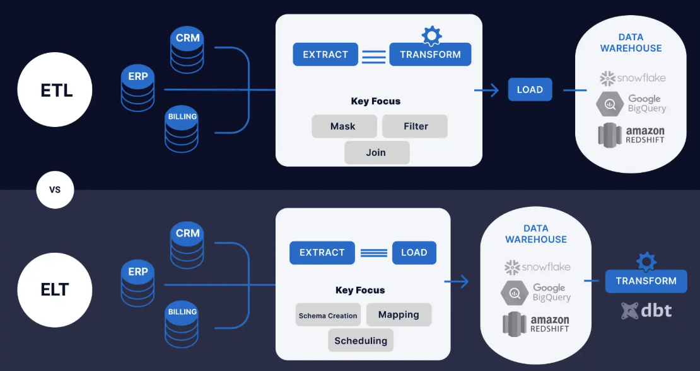
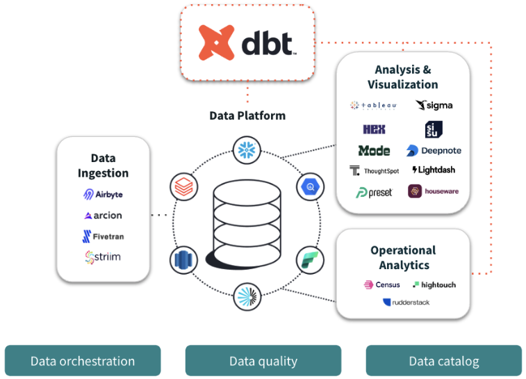
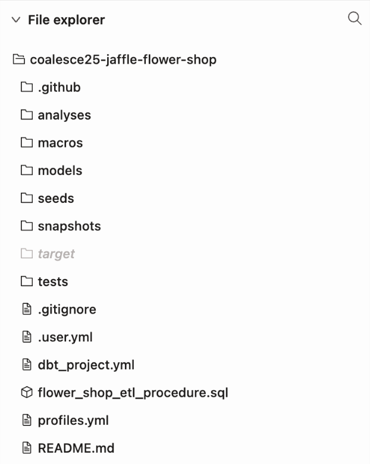
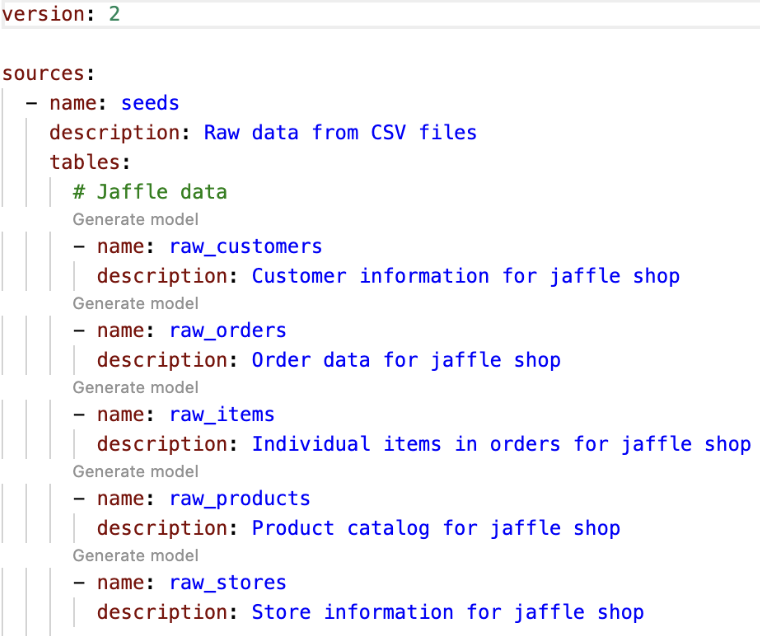
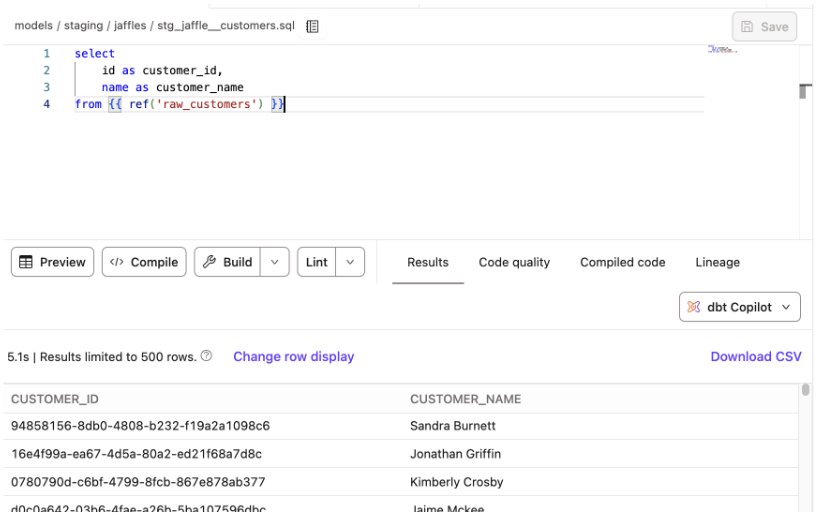
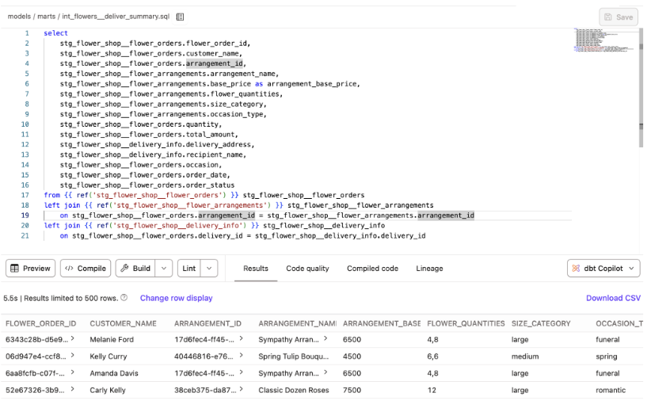
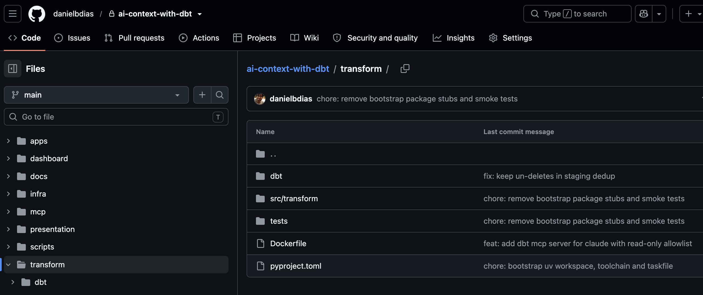
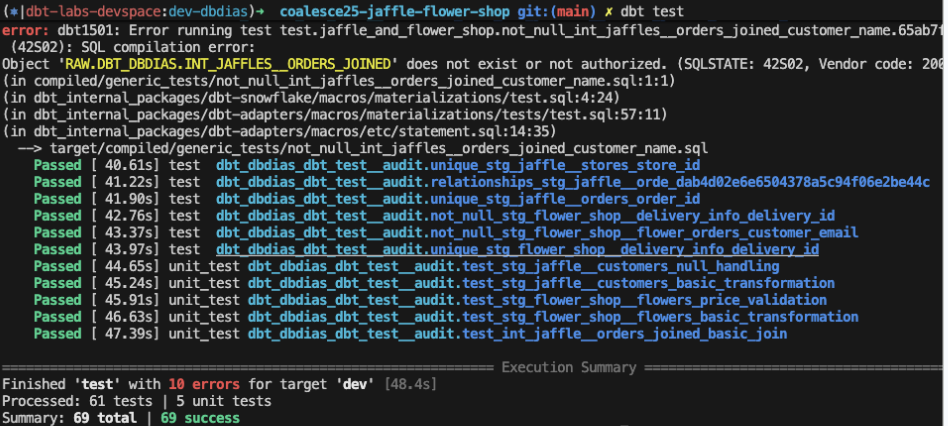
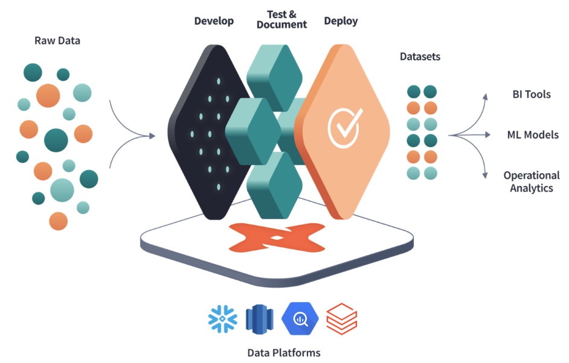

<script type="module">
  import mermaid from "https://cdn.jsdelivr.net/npm/mermaid@11.4.1/dist/mermaid.esm.min.mjs";
  mermaid.initialize({
    startOnLoad: true,
    theme: "neutral",
    fontFamily: "Helvetica, Arial, sans-serif",
    // Marp's PDF export drops glyphs from Mermaid's HTML (foreignObject)
    // labels, so render every label as plain SVG text instead. Node labels
    // read the top-level flag; subgraph titles read the flowchart one.
    htmlLabels: false,
    flowchart: {
      htmlLabels: false,
      useMaxWidth: false,
      nodeSpacing: 22,
      rankSpacing: 55,
      wrappingWidth: 280,
    },
  });
</script>

<!-- _class: titlepage -->

# De data ingestion a context engineering

## Construindo contextos confiáveis para agentes de IA com dbt

---

<!-- _class: split -->

# Daniel Dias


<div>

**Senior Software Engineer, Fivetran + dbt Labs**

Doutorando em IA na USP, apaixonado por criar dev tools

- LinkedIn: [@danielbdias](https://linkedin.com/in/danielbdias)
- Github: [@danielbdias](https://github.com/danielbdias)

</div>

---

# Um "contexto" sobre contextos

Um agente de IA que responde perguntas sobre os seus dados é tão bom quanto o
**significado** associado a esses dados.

- Sem definições, a mesma pergunta recebe números diferentes de agentes
  diferentes.
- Sem regras de acesso, um agente pode ler o que não deveria.
- Sem testes, ninguém percebe quando a resposta está errada.

**Context engineering** é dar ao agente as informações, definições e limites
certos para que ele responda corretamente. Para dados, esse contexto é
construído na *camada de transformação*.

---

<!-- _class: transition2 -->

# Mas antes... o que é a camada de transformação?

---

<!-- _class: diagram -->

# Um desafio: mudanças nos dados de um hospital

- Temos um processo de ETL que extrai e transmite dados para o data lake do
hospital. Isso permite que os analistas gerem relatórios estratégicos.
- **O processo funciona perfeitamente!**

<div class="mermaid">
flowchart LR
  subgraph sources["Fontes"]
    direction TB
    records["Cadastro de pacientes"]
    accounting["Dados contábeis entre<br/>planos de saúde e o hospital"]
    exams["Bancos locais com<br/>resultados de exames"]
    more["…"]
  end
  subgraph etl["Pipeline de ETL"]
    direction LR
    extract["Extract"] --> transform["Transform"] --> load["Load"]
  end
  records --> extract
  accounting --> extract
  exams --> extract
  more --> extract
  load --> warehouse[("Data Warehouse")]
</div>

---

# Um desafio: mudanças nos dados de um hospital

- Um órgão regulador pediu recentemente dados adicionais nesses relatórios,
incluindo **Informações de Identificação Pessoal (PII)** rastreáveis.

<div class="mermaid">
flowchart LR
  subgraph sources["Fontes"]
    direction TB
    records["Cadastro de pacientes"]
    accounting["Dados contábeis entre<br/>planos de saúde e o hospital"]
    exams["Bancos locais com<br/>resultados de exames"]
    more["…"]
  end
  subgraph etl["Pipeline de ETL"]
    direction LR
    extract["Extract"] --> transform["Transform ⚠️<br/>Agora precisa tratar PII:<br/>rastrear e proteger"] --> load["Load"]
  end
  records --> extract
  accounting --> extract
  exams --> extract
  more --> extract
  load --> warehouse[("Data Warehouse")]
  classDef warn fill:#fff3cd,stroke:#e69500,stroke-width:4px,color:#8a5a00,font-weight:bold
  class transform warn
</div>

---

<!-- _class: media -->

# A reação dos engenheiros de dados à notícia

<div class="media-frame">
  
  
</div>

---

# Pontos de atrito no ETL

Como a transformação está acoplada à extração, precisamos criar rotinas de transformação separadas só para os dados novos, e passar dias ou semanas executando o job.

<div class="mermaid">
flowchart LR
  subgraph sources["Fontes"]
    direction TB
    records["Cadastro de pacientes"]
    accounting["Dados contábeis entre<br/>planos de saúde e o hospital"]
    exams["Bancos locais com<br/>resultados de exames"]
    more["…"]
  end
  subgraph etl["Pipeline de ETL"]
    direction LR
    extract["Extract"] --> transform["Transform ⚠️<br/>Retrabalho por campo:<br/>dias ou semanas"] --> load["Load"]
  end
  records --> extract
  accounting --> extract
  exams --> extract
  more --> extract
  load --> warehouse[("Data Warehouse")]
  classDef hot fill:#ffe0e0,stroke:#d00,stroke-width:4px,color:#900,font-weight:bold
  class transform hot
</div>

---

<!-- _class: media -->

# A reação dos engenheiros de dados, parte dois

<div class="media-frame">
  
  
</div>

---

# Pensando em ETL

- ETL é um processo otimizado para carregar e estruturar os dados antes que cheguem ao data warehouse.

- Mas ele pode ser inflexível em alguns cenários, gerando mais trabalho para a equipe de dados.

---

<!-- _class: transition2 -->

# E se invertêssemos o paradigma?

---

<!-- _class: fitted shrink -->

# Entra em cena o ELT!



<p class="source">Fonte: <a href="https://www.dio.me/articles/a-importancia-do-elt-e-etl-no-processo-de-engenharia-de-dados">https://www.dio.me/articles/a-importancia-do-elt-e-etl-no-processo-de-engenharia-de-dados</a></p>

---

<!-- _class: diagram -->

# Um novo workflow para o problema

<div class="mermaid">
flowchart LR
  subgraph sources["Fontes"]
    direction TB
    records["Cadastro de pacientes"]
    accounting["Dados contábeis entre<br/>planos de saúde e o hospital"]
    exams["Bancos locais com<br/>resultados de exames"]
    more["…"]
  end
  subgraph elt["Pipeline de ELT"]
    direction LR
    extract["Extract and Load"] --> warehouse[("Data warehouse")]
    warehouse --> transform["Transform"]
    transform --> warehouse
  end
  records --> extract
  accounting --> extract
  exams --> extract
  more --> extract
</div>

A transformação agora acontece **dentro do warehouse**.

---

<!-- _class: split -->

# Como o ELT pode te ajudar?

<div>

- Transformação de dados flexível
- Menor custo e tempo de processamento
- Auditoria e governança de dados mais fáceis
- Melhor escalabilidade e desempenho

</div>


---

# ELT não é de graça

- **O custo de compute vai para o warehouse.** Fique de olho nos créditos e
  mantenha os models incrementais quando os dados forem grandes.
- **Os dados brutos chegam primeiro.** No caso do hospital, isso significa PII
  bruta no warehouse. Mascare ou remova colunas sensíveis em uma camada de
  staging e conceda acesso em schemas, não em tabelas.
- **O ETL ainda tem seu lugar.** Se um campo nunca pode chegar ao warehouse,
  remova-o antes do load. 
- **Um bom ELT exige disciplina.** Testes, descrições e responsáveis, ou o
  warehouse vira um pântano.

---

<!-- _class: transition2 -->

# Ótimo… mas o que é o dbt? E como ele se encaixa nisso?

---

<!-- _class: split -->

# O que é o dbt?

<div>

- O **dbt (data build tool)** é uma ferramenta open-source que traz as boas práticas de engenharia de software para a transformação de dados.

- Permite que transformações, testes e implementações de modelos de dados sejam implementados facilmente em sua data warehouse.

- Atualmente na **v2**, sob a licença Apache 2.0: <https://github.com/dbt-labs/dbt>

</div>


---

<!-- _class: fitted shrink -->

# Como o dbt interage com o ecossistema de dados



---

<!-- _class: split -->

# Como a transformação é feita?

<div>

- A transformação no dbt é estruturada como um projeto com código-fonte em SQL, YAML e Python.

</div>



---

<!-- _class: split -->

# Como a transformação é feita?

<div>

- A transformação no dbt é estruturada como um projeto com código-fonte em SQL, YAML e Python.

- As tabelas carregadas pela etapa de Extract & Load são declaradas como **sources**.

</div>



---

# Um modelo é só um SELECT

```sql
select
    id as submission_id,
    max_by(message, updated_at) as message
from {{ source('app', 'submissions') }}   -- uma tabela carregada por Extract & Load
group by id
```

- `source()` aponta para uma tabela bruta. `ref()` aponta para outro model ou seed.
- O dbt monta o grafo de dependências a partir deles e executa os models em ordem.
- O nome do arquivo vira o nome da tabela no warehouse.

---

<!-- _class: split -->

# Como a transformação é feita?

<div>

- A transformação no dbt é estruturada como um projeto com código-fonte em SQL, YAML e Python.

- As tabelas carregadas pela etapa de Extract & Load são declaradas como **sources**.

- As sources são então expostas por meio de **models**, escritos como *selects em SQL*.

</div>



---

<!-- _class: split -->

# Como a transformação é feita?

<div>

- A transformação no dbt é estruturada como um projeto com código-fonte em SQL, YAML e Python.

- As tabelas carregadas pela etapa de Extract & Load são declaradas como **sources**.

- As sources são então expostas por meio de **models**, escritos como *selects em SQL*.

- Com esses models podemos estruturar as **regras de negócio** da transformação e alterá-las facilmente quando necessário.

</div>



---

# Boas práticas de engenharia de software

O código do seu projeto dbt pode ficar em um repositório como o GitHub.



---

# Boas práticas de engenharia de software

O código do seu projeto dbt pode ficar em um repositório como o GitHub.

O projeto pode ser **testado** para que seus dados cheguem à produção com segurança.



---

<!-- _class: fitted -->

# ELT executado com dbt



---

# Extra: Semantic Layer

- **Semantic Layer**: um lugar único onde as métricas do negócio são definidas
  uma vez, em código, e reutilizadas por BI, apps e agentes de IA.
- **MetricFlow**: o motor do dbt que lê essas definições e gera o SQL correto
  para cada pergunta, com os joins, filtros e agregações certos.
- Resultado: `mobile_share` significa a mesma coisa em qualquer lugar.

```yaml
metrics:
  - name: mobile_share
    type: ratio
    numerator: mobile_submissions
    denominator: submissions_count
```

---

# Extra: dbt Charts

- **dbt Charts**: dashboards definidos como código. Cada board é um arquivo
  YAML com queries e gráficos, versionado no git junto com o projeto dbt.
- As queries usam `ref()` para ler os marts, então o dashboard segue o mesmo
  lineage, os mesmos testes e as mesmas permissões do resto do projeto.
- O `dct serve` renderiza cada board em uma página web (`/overview/`, `/words/`).

```yaml
queries:
  top_words:
    sql: SELECT display_word, frequency FROM {{ ref('mart_word_frequencies') }}
charts:
  top_words:
    query: top_words
    type: bar
```

---

<!-- _class: transition2 -->

# Hora da demonstração!

---

<!-- _class: media -->

# Hora da demonstração!

<div class="media-frame">
  
  
</div>

---

<!-- _class: diagram -->

# Hora da demonstração

Repositório de exemplo: <https://github.com/danielbdias/ai-context-with-dbt>

<div class="mermaid">
flowchart LR
  form["Formulário<br/>apps/web"] --> pg[("Postgres")]
  pg --> dlt["dlt<br/>apps/el"]
  dlt --> raw[("Snowflake RAW")]
  raw --> dbt["dbt<br/>transform/dbt"]
  dbt --> marts[("marts")]
  marts --> charts["dbt Charts"]
  marts --> mcp["dbt MCP<br/>Claude"]
</div>

<!--
Executar antes da palestra (Docker, cerca de 6 GB de RAM): task setup, up, seed,
el, dbt:build, dashboard, mcp:build.
-->

---

# Sources e models

- **Source**: `transform/dbt/models/staging/_sources.yml` declara
  `raw.submissions`, com freshness (warn após 24h) e descrições.
- **Model**: `stg_app__submissions.sql` deduplica com `max_by` e mapeia
  browsers e sistemas operacionais por meio de seeds, usando `Other` como
  fallback.

<!--
Ao vivo: task app:open, enviar uma mensagem (senha dssbr, apenas para a demo),
depois task el && task dbt:build. Opcional: task dbt:docs para ver o lineage em
:8081.
-->

---

# Regras de negócio e testes

- **Mudar uma regra**: edite `seeds/browser_family_map.csv`, rode
  `task dbt:build`, e os gráficos mudam. Sem retrabalho no pipeline.
- **Garantir uma regra**: o macro `normalize_token` e o generic test
  `no_stopwords` mantêm `café` igual a `cafe` e removem stopwords.
- **Git**: é um repositório como qualquer outro, com Conventional Commits e PRs.

<!-- Ao vivo: task dashboard, depois abrir /overview/ e /words/. -->

---

# dbt como contexto do agente

- Todo model e coluna tem uma **descrição**, garantida por
  `task dbt:coverage`. Os marts informam seu grain e uma query de exemplo.
- O Claude consulta os marts por meio de um servidor **dbt MCP** somente leitura.
- Os guardrails se sustentam sozinhos: o usuário `mcp_reader` só pode fazer
  `SELECT` em `marts`, então ler `staging` ou `raw` falha.
- O controle de PII está nos grants e no desenho da ingestão, não em um macro do dbt.

<!--
Ao vivo: rodar claude na raiz do repositório e perguntar "quais são os top
browsers?". Depois pedir que ele leia staging ou raw para mostrar ACCESS_DENIED.
Plano B: task mcp:smoke.
-->

---

# Uma definição para todos os agentes

- As métricas ficam em `marts/_marts.yml`, ao lado do model que descrevem, por
  exemplo `mobile_share` (a razão entre `mobile_submissions` e
  `submissions_count`).
- O Semantic Layer (MetricFlow) escreve o SQL, então dois agentes que pedem
  `mobile_share` recebem a mesma resposta.
- Os agentes chamam `list_metrics` e `query_metrics` primeiro. Só recorrem a
  `show` em um mart quando nenhuma métrica atende.

```json
{"metrics": ["submissions_count"],
 "group_by": [{"name": "submission__browser", "type": "dimension"}],
 "limit": 3}
```

<!--
Ao vivo: perguntar ao Claude "qual é o mobile share por mês?" e mostrar a
chamada de query_metrics. Depois pedir um número que nenhuma métrica define,
para mostrar o fallback para show. Precisa da dbt platform
(docs/semantic-layer.md).
-->

---

<!-- _class: transition2 -->

# Recapitulando...

---

# O que muda para o time

| Antes | Com ELT, dbt e contexto |
|---|---|
| Campo novo exige um pipeline novo | Campo novo exige um model SQL novo |
| Métrica definida em cada relatório | Métrica definida uma vez, no git |
| O agente adivinha pelos nomes das tabelas | O agente lê descrições e métricas |
| Acesso definido em cada ferramenta | Acesso definido nos grants, em um só lugar |

**Trade-offs para planejar:** créditos do warehouse, o esforço de escrever
descrições e a dependência de plataforma (Snowflake, dbt platform).

---

# Posso construir um contexto para IA também?

1. Escolha **um domínio** e carregue os dados brutos com uma ferramenta de EL.
2. Construa staging e marts no dbt, com testes e uma descrição para cada
   coluna.
3. Defina, no Semantic Layer, as 3 a 5 métricas sobre as quais as pessoas
   discutem.
4. Dê a um agente somente leitura os marts e nada mais, depois compare as
   respostas dele com um relatório em que você confia.

---

# Conclusões

- O **ELT** torna a mudança barata, porque a transformação vive no warehouse.
- O **dbt** torna essa lógica revisável, testada e documentada.
- **Descrições, métricas e grants** são o contexto que torna as respostas de um
  agente confiáveis.

---

# Saiba mais

- **Extensão do Visual Studio Code**: <https://marketplace.visualstudio.com/items?itemName=dbtLabsInc.dbt>
- **dbt v2**: <https://github.com/dbt-labs/dbt>
- **Documentação**: <https://docs.getdbt.com/>
- **Repositório de exemplo**: <https://github.com/danielbdias/ai-context-with-dbt>

---

<!-- _class: thanks -->

# Obrigado!


<div>

[getdbt.com](https://getdbt.com)

@danielbdias

</div>


