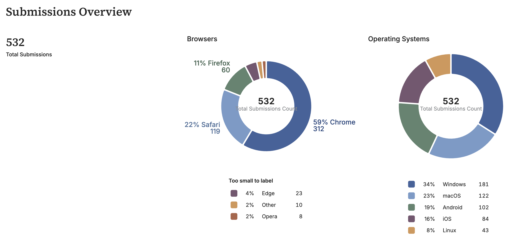

<script type="module">
  import mermaid from "https://cdn.jsdelivr.net/npm/mermaid@11.4.1/dist/mermaid.esm.min.mjs";
  mermaid.initialize({
    startOnLoad: true,
    theme: "neutral",
    fontFamily: "Helvetica, Arial, sans-serif",
    // Marp's PDF export drops glyphs from Mermaid's HTML (foreignObject)
    // labels, so render every label as plain SVG text instead. Node labels
    // read the top-level flag; subgraph titles read the flowchart one.
    htmlLabels: false,
    flowchart: {
      htmlLabels: false,
      useMaxWidth: false,
      nodeSpacing: 22,
      rankSpacing: 55,
      wrappingWidth: 280,
    },
  });
</script>

<!-- _class: titlepage -->

# From data ingestion to context engineering

## Building reliable AI agent contexts with dbt

---

<!-- _class: split -->

# Daniel Dias


<div>

**Senior Software Engineer, Fivetran + dbt Labs**

PhD candidate in AI at USP, passionate about building dev tools

- LinkedIn: [@danielbdias](https://linkedin.com/in/danielbdias)
- Github: [@danielbdias](https://github.com/danielbdias)

</div>

---

# A "context" about contexts

An AI agent that answers questions about your data is only as good as the
**meaning** attached to that data.

- Without definitions, the same question gets different numbers from different
  agents.
- Without access rules, an agent can read what it should not.
- Without tests, nobody notices when the answer is wrong.

**Context engineering** is giving an agent the right information, definitions
and limits to answer correctly. For data, that context is built in the
*transformation layer*.

---

<!-- _class: transition2 -->

# But first... what is the transformation layer?

---

<!-- _class: diagram -->

# A challenge: data changes at a hospital

- We have an ETL process that extracts and streams data into the hospital's data
lake. That lets the analysts produce strategic reports.
- **The process works perfectly!**

<div class="mermaid">
flowchart LR
  subgraph sources["Sources"]
    direction TB
    records["Patient records"]
    accounting["Accounting data between<br/>health plans and the hospital"]
    exams["Local databases with<br/>exam results"]
    more["…"]
  end
  subgraph etl["ETL pipeline"]
    direction LR
    extract["Extract"] --> transform["Transform"] --> load["Load"]
  end
  records --> extract
  accounting --> extract
  exams --> extract
  more --> extract
  load --> warehouse[("Data Warehouse")]
</div>

---

# A challenge: data changes at a hospital

- A regulator recently asked for additional data in those reports, including
traceable **Personally Identifiable Information (PII)**.

<div class="mermaid">
flowchart LR
  subgraph sources["Sources"]
    direction TB
    records["Patient records"]
    accounting["Accounting data between<br/>health plans and the hospital"]
    exams["Local databases with<br/>exam results"]
    more["…"]
  end
  subgraph etl["ETL pipeline"]
    direction LR
    extract["Extract"] --> transform["Transform ⚠️<br/>Must now handle PII:<br/>trace it, protect it"] --> load["Load"]
  end
  records --> extract
  accounting --> extract
  exams --> extract
  more --> extract
  load --> warehouse[("Data Warehouse")]
  classDef warn fill:#fff3cd,stroke:#e69500,stroke-width:4px,color:#8a5a00,font-weight:bold
  class transform warn
</div>

---

<!-- _class: media -->

# The data engineers' reaction to the news

<div class="media-frame">
  
  
</div>

---

# Friction points in ETL

Because the transformation is coupled to the extraction, we have to build separate transformation routines just for the new data, and spend days or weeks running the job.

<div class="mermaid">
flowchart LR
  subgraph sources["Sources"]
    direction TB
    records["Patient records"]
    accounting["Accounting data between<br/>health plans and the hospital"]
    exams["Local databases with<br/>exam results"]
    more["…"]
  end
  subgraph etl["ETL pipeline"]
    direction LR
    extract["Extract"] --> transform["Transform ⚠️<br/>Rework for each new field:<br/>days or weeks"] --> load["Load"]
  end
  records --> extract
  accounting --> extract
  exams --> extract
  more --> extract
  load --> warehouse[("Data Warehouse")]
  classDef hot fill:#ffe0e0,stroke:#d00,stroke-width:4px,color:#900,font-weight:bold
  class transform hot
</div>

---

<!-- _class: media -->

# The data engineers' reaction, take two

<div class="media-frame">
  
  
</div>

---

# Thinking about ETL

- ETL is a process optimized for loading and structuring data before it reaches the data warehouse.

- But it can be inflexible in some scenarios, creating more work for the data team.

---

<!-- _class: transition2 -->

# What if we flipped the paradigm?

---

<!-- _class: fitted shrink -->

# Enter ELT!


<p class="source">Source: <a href="https://www.dio.me/articles/a-importancia-do-elt-e-etl-no-processo-de-engenharia-de-dados">https://www.dio.me/articles/a-importancia-do-elt-e-etl-no-processo-de-engenharia-de-dados</a></p>

---

<!-- _class: diagram -->

# A new workflow for the problem

<div class="mermaid">
flowchart LR
  subgraph sources["Sources"]
    direction TB
    records["Patient records"]
    accounting["Accounting data between<br/>health plans and the hospital"]
    exams["Local databases with<br/>exam results"]
    more["…"]
  end
  subgraph elt["ELT pipeline"]
    direction LR
    extract["Extract and Load"] --> warehouse[("Data warehouse")]
    warehouse --> transform["Transform"]
    transform --> warehouse
  end
  records --> extract
  accounting --> extract
  exams --> extract
  more --> extract
</div>

The transformation now runs **inside the warehouse**.

---

<!-- _class: split -->

# How can ELT help you?

<div>

- Flexible data transformation
- Lower cost and processing time
- Easier data auditing and governance
- Better scalability and performance

</div>


---

# ELT is not free

- **Compute cost moves to the warehouse.** Watch credits, and keep models
  incremental where data is large.
- **Raw data lands first.** For the hospital, that means raw PII sits in the
  warehouse. Mask or drop sensitive columns in a staging layer, and grant
  access on schemas, not tables.
- **ETL still has a place.** If a field must never reach the warehouse, remove
  it before the load.
- **Good ELT needs discipline.** Tests, descriptions and ownership, or the
  warehouse becomes a swamp.

---

<!-- _class: transition2 -->

# Great… but what is dbt? And how does it fit in?

---

<!-- _class: split -->

# What is dbt?

<div>

- **dbt (data build tool)** is an open-source tool that brings software
engineering best practices to data transformation.

- It lets you implement transformations, tests and data model deployments
easily in your data warehouse.

- Currently on **v2**, under the Apache 2.0 license: <https://github.com/dbt-labs/dbt>

</div>


---

<!-- _class: fitted shrink -->

# How dbt interacts with the data ecosystem


---

<!-- _class: split -->

# How is the transformation done?

<div>

- Transformation in dbt is structured as a project with source code in SQL, YAML and Python.

</div>


---

<!-- _class: split -->

# How is the transformation done?

<div>

- Transformation in dbt is structured as a project with source code in SQL, YAML and Python.

- The tables loaded by the Extract & Load step are declared as **sources**.

</div>


---

# A model is just a SELECT

```sql
select
    id as submission_id,
    max_by(message, updated_at) as message
from {{ source('app', 'submissions') }}   -- a table loaded by EL
group by id
```

- `source()` points to a raw table. `ref()` points to another model or seed.
- dbt builds the dependency graph from them and runs models in order.
- The file name becomes the table name in the warehouse.

---

<!-- _class: split -->

# How is the transformation done?

<div>

- Transformation in dbt is structured as a project with source code in SQL, YAML and Python.

- The tables loaded by the Extract & Load step are declared as **sources**.

- Sources are then exposed through **models**, written as *SQL selects*.

</div>


---

<!-- _class: split -->

# How is the transformation done?

<div>

- Transformation in dbt is structured as a project with source code in SQL, YAML and Python.

- The tables loaded by the Extract & Load step are declared as **sources**.

- Sources are then exposed through **models**, written as *SQL selects*.

- With those models we can structure the **business rules** of the transformation and change them easily when needed.

</div>


---

# Software engineering best practices

Your dbt project code can live in a repository like GitHub.


---

# Software engineering best practices

Your dbt project code can live in a repository like GitHub.

The project can be **tested** so your data ships to production safely.


---

<!-- _class: fitted -->

# ELT run with dbt


---

# Extra: Semantic Layer

- **Semantic Layer**: a single place where business metrics are defined once,
  in code, and reused by BI tools, apps and AI agents.
- **MetricFlow**: the dbt engine that reads those definitions and generates the
  right SQL for each question, with the correct joins, filters and aggregations.
- Result: `mobile_share` means the same thing everywhere.

```yaml
metrics:
  - name: mobile_share
    type: ratio
    numerator: mobile_submissions
    denominator: submissions_count
```

---

# Extra: dbt Charts

- **dbt Charts**: dashboards defined as code. Each board is a YAML file with
  queries and charts, versioned in git alongside the dbt project.
- Queries use `ref()` to read the marts, so the dashboard follows the same
  lineage, tests and permissions as the rest of the project.
- `dct serve` renders each board as a web page (`/overview/`, `/words/`).

```yaml
queries:
  top_words:
    sql: SELECT display_word, frequency FROM {{ ref('mart_word_frequencies') }}
charts:
  top_words:
    query: top_words
    type: bar
```

---

# Extra: dbt Charts



---

<!-- _class: transition2 -->

# Demo time!

---

<!-- _class: media -->

# Demo time!

<div class="media-frame">
  
  
</div>

---

<!-- _class: diagram -->

# Demo time

Example repo: <https://github.com/danielbdias/ai-context-with-dbt>

<div class="mermaid">
flowchart LR
  form["Form<br/>apps/web"] --> pg[("Postgres")]
  pg --> dlt["dlt<br/>apps/el"]
  dlt --> raw[("Snowflake RAW")]
  raw --> dbt["dbt<br/>transform/dbt"]
  dbt --> marts[("marts")]
  marts --> charts["dbt Charts"]
  marts --> mcp["dbt MCP<br/>Claude"]
</div>

<!--
Pre-run before the talk (Docker, about 6 GB RAM): task setup, up, seed, el,
dbt:build, dashboard, mcp:build.
-->

---

# Sources and models

- **Source**: `transform/dbt/models/staging/_sources.yml` declares
  `raw.submissions`, with freshness (warn after 24h) and descriptions.
- **Model**: `stg_app__submissions.sql` deduplicates with `max_by` and maps
  browsers and OSes through seeds, with `Other` as the fallback.

<!--
Live: task app:open, submit a message (password dssbr, demo only), then
task el && task dbt:build. Optional: task dbt:docs for lineage on :8081.
-->

---

# Business rules and tests

- **Change a rule**: edit `seeds/browser_family_map.csv`, run
  `task dbt:build`, and the charts change. No pipeline rework.
- **Enforce a rule**: the `normalize_token` macro and the `no_stopwords`
  generic test keep `café` equal to `cafe` and drop stopwords.
- **Git**: it is a repo like any other, with Conventional Commits and PRs.

<!-- Live: task dashboard, then open /overview/ and /words/. -->

---

# dbt as the agent's context

- Every model and column has a **description**, enforced by
  `task dbt:coverage`. Marts state their grain and an example query.
- Claude queries the marts through a read-only **dbt MCP** server.
- Guardrails hold on their own: the `mcp_reader` user can only `SELECT` from
  `marts`, so reading `staging` or `raw` fails.
- PII control lives in the grants and the ingestion design, not in a dbt macro.

<!--
Live: run claude at the repo root and ask "what are the top browsers?". Then
ask it to read staging or raw to show ACCESS_DENIED. Fallback: task mcp:smoke.
-->

---

# One definition for every agent

- Metrics live in `marts/_marts.yml`, next to the model they describe, for
  example `mobile_share` (a ratio of `mobile_submissions` to
  `submissions_count`).
- The Semantic Layer (MetricFlow) writes the SQL, so two agents asking for
  `mobile_share` get the same answer.
- Agents call `list_metrics` and `query_metrics` first. They fall back to
  `show` on a mart only when no metric fits.

```json
{"metrics": ["submissions_count"],
 "group_by": [{"name": "submission__browser", "type": "dimension"}],
 "limit": 3}
```

<!--
Live: ask Claude "what is the mobile share by month?" and show the
query_metrics call. Then ask for a number no metric defines, to show the
fallback to show. Needs the dbt platform (docs/semantic-layer.md).
-->

---

<!-- _class: transition2 -->

# Recapping...

---

# What changes for the team

| Before | With ELT, dbt and context |
|---|---|
| New field means a new pipeline | New field means a new SQL model |
| Metric defined in each report | Metric defined once, in git |
| Agent guesses from table names | Agent reads descriptions and metrics |
| Access fixed per tool | Access fixed in grants, in one place |

**Trade-offs to plan for:** warehouse credits, the effort of writing
descriptions, and the platform dependency (Snowflake, dbt platform).

---

# Can I build a context for AI too?

1. Pick **one domain** and load it raw with an EL tool.
2. Build staging and marts in dbt, with tests and a description for every
   column.
3. Define the 3 to 5 metrics people argue about, in the Semantic Layer.
4. Give a read-only agent the marts and nothing else, then check its answers
   against a report you trust.

---

# Takeaways

- **ELT** makes change cheap, because transformation lives in the warehouse.
- **dbt** makes that logic reviewable, tested and documented.
- **Descriptions, metrics and grants** are the context that makes an agent's
  answers trustworthy.

---

# Learn more

- **Visual Studio Code extension**: <https://marketplace.visualstudio.com/items?itemName=dbtLabsInc.dbt>
- **dbt v2**: <https://github.com/dbt-labs/dbt>
- **Documentation**: <https://docs.getdbt.com/>
- **Example repo**: <https://github.com/danielbdias/ai-context-with-dbt>

---

<!-- _class: thanks -->

# Thank you!


<div>

[getdbt.com](https://getdbt.com)

@danielbdias

</div>


